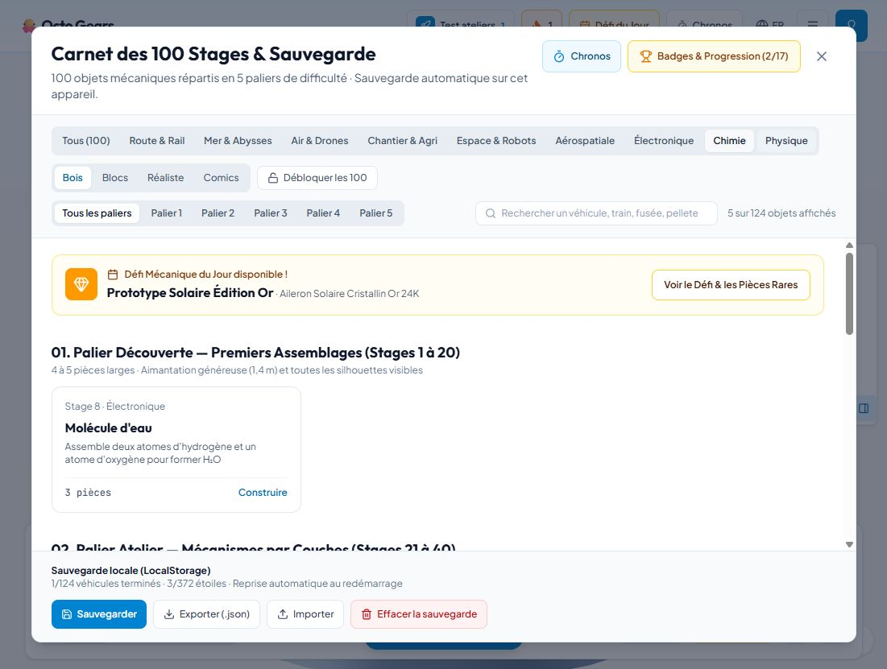

# Bilan qualité des ateliers — 5 novembre 2026

**Suivi :** les corrections et leur revalidation sont décrites dans [Validation des corrections](2026-11-05-validation-corrections.md). Ce document conserve les constats de l’audit initial ; le JSON d’audit est régénéré sur la version courante.

## Périmètre et verdict

Audit de **9 catégories, 124 modèles, 1 055 pièces**. Le catalogue est structurellement assemblable, mais **la conformité pédagogique et visuelle n'est pas validée**. Les défauts STEM et de libellés sont confirmés. Aucun correctif produit ni déploiement dans cette passe d'audit.

Application de test : http://localhost:7301 (port 7300 déjà occupé par une autre instance ; page blanche observée sur cette instance). Profil local jetable « Test ateliers », français, 5–7 ans. Ne pas arrêter l'autre instance sans identifier son propriétaire. Le serveur 7301 signale un conflit de port HMR 24678 avec l'autre instance : recharger manuellement en cas de modification.

Exécuté : contrôle de données sur tous les modèles ; construction des géométries des 1 055 pièces en style Blocs sans GPU ; vérification des neuf filtres dans le navigateur ; ouverture du premier modèle de chaque catégorie ; montage complet par glisser-déposer de l'eau et du pendule ; contrôle des erreurs console (aucune erreur capturée à la fin du parcours).

Vérifications finales : `npm run lint` réussi ; `npm test` **234/234 tests réussis dans 14 fichiers**, dont 125 nouveaux contrôles d'intégrité du catalogue. L'audit géométrique a terminé sans erreur structurelle. Les défauts métier décrits plus bas restent ouverts.

Non exécuté : 124 montages complets au doigt, quatre styles graphiques sur chaque appareil, test hors-ligne de production, mesures GPU/FPS, parcours complet EN/AR dans l'interface. Les contrôles de traduction ci-dessous utilisent les données localisées, pas une certification linguistique. Les modèles des paliers supérieurs restent verrouillés pour le profil de test ; leur contrôle ici porte sur les données et géométries.

## Résultats par catégorie

| Catégorie | Modèles | Pièces | Filtre UI | Modèles avec écart AABB à examiner |
|---|---:|---:|---|---:|
| Route & Rail | 21 | 196 | OK | 9 |
| Mer & Abysses | 21 | 190 | OK | 4 |
| Air & Drones | 21 | 196 | OK | 10 |
| Chantier & Agri | 21 | 183 | OK | 9 |
| Espace & Robots | 20 | 164 | OK | 6 |
| Aérospatiale | 5 | 41 | OK | 2 |
| Électronique | 5 | 29 | OK | 4 |
| Chimie | 5 | 29 | OK, étiquette des cartes incorrecte | 3 |
| Physique | 5 | 27 | OK, étiquette des cartes incorrecte | 5 |
| **Total** | **124** | **1 055** | **9/9 filtres** | **52** |

Les 52 cas sont des **candidats de revue**, pas 52 bugs confirmés : `dependsOn` décrit un préalable de montage, pas nécessairement un contact. Une distance entre boîtes englobantes ne prouve ni une erreur ni une connexion réelle ; des boîtes qui se touchent ne garantissent pas non plus un assemblage correct. Les mesures sont en unités de scène, avec rotations appliquées. Le style Blocs et les détails géométriques influencent les boîtes. Aucune conclusion sur les collisions fines ou les performances de rendu.

## Défauts confirmés et priorités proposées

### QA-01 — Critique : modèles STEM différents de la consigne

Source : `src/data/catalogTemplates.ts`, `fleetElectronique.ts`, `fleetChimie.ts`, `fleetPhysique.ts`. Un seul archétype par discipline, filtré par niveau, fabrique des objets aux titres pourtant différents.

- Eau : O + H + une liaison, au lieu de H₂O. Montage complet **accepté dans le navigateur**, bouton « Stage suivant » activé. L'angle H–O–H annoncé ne peut pas exister.
- CO₂ : O central + deux H + deux liaisons simples ; ni carbone central ni deux oxygènes périphériques ni liaisons doubles.
- Cristal NaCl : même motif oxygène/hydrogène avec un erlenmeyer ; absence de réseau sodium/chlorure.
- Bécher sur pied et Balance de précision : motif moléculaire enrichi, sans assemblage fidèle au titre. La balance n'a ni fléau ni plateaux.
- Circuit LED : platine + pile + LED ; résistance et fil annoncés absents au niveau 1.
- Ventilateur : le moteur n'arrive dans l'archétype qu'au niveau 4, alors que ce modèle est au niveau 2.
- Alarme : pas de capteur de lumière ni de buzzer dans les pièces générées.
- Jouet solaire : panneau disponible seulement au niveau 5, modèle au niveau 4.
- Radio AM : archétype de circuit générique, sans antenne ni démodulateur ni casque annoncés.
- Physique : le levier, le plan incliné, la boussole et le prisme conservent le support/mât/masse de pendule, puis accumulent les composants des niveaux précédents. Ce sont des collections de composants, pas des montages dédiés à chaque expérience.

**Amélioration** : un blueprint spécifique par expérience, avec composants et connexions explicites. Simplifier les détails selon l'âge sans retirer les composants essentiels. Ajouter des tests sémantiques H₂O/CO₂, moteur, panneau solaire, buzzer et balance ; ne pas se limiter au nombre de pièces.

### QA-02 — Haute : pendule validé avec masse flottante

Reproduction : Physique → Pendule simple → poser support, mât et masse. Les trois pièces deviennent « Fixée » et le niveau est réussi, mais la masse est à côté du mât, sans fil ni tige de suspension. Écart entre boîtes du mât et de la masse : **0,23 unité**. Confirmé visuellement après montage.

**Amélioration** : séparer support, pivot et élément suspendu ; définir les points de connexion et un mouvement autour du pivot. Contrôler les contacts obligatoires et les pénétrations en vues face/profil/dessus.

### QA-03 — Haute : validation scientifique absente de la réussite

`src/App.tsx` calcule la réussite sur le nombre de pièces placées. `useCircuitValidator` et `useValenceValidator` ne sont pas utilisés par l'application en dehors de leurs propres modules/tests.

Appel direct sur les modèles réellement générés : 3/5 montages Chimie complets sont refusés par `validateValence` (eau, bécher, balance). Le CO₂ erroné est accepté, car le validateur vérifie les formes présentes et non la formule attendue. `validateCircuit` accepte un ensemble vide pour les 5 modèles électroniques ; il ne vérifie que les dépendances des pièces déjà placées, pas un circuit électrique fermé. Ce résultat n'établit pas à lui seul un faux succès UI sur circuit vide : l'UI vérifie le nombre de pièces séparément.

**Amélioration** : distinguer graphe de montage, graphe électrique et graphe moléculaire. Modéliser les deux extrémités et l'ordre des liaisons ; une double liaison compte pour deux, contrairement au comptage actuel. Brancher la validation à la réussite seulement après correction des données et du validateur. Préserver un retour bienveillant pour l'enfant.

### QA-04 — Haute : catégories affichées incohérentes

`StageCatalogModal.tsx:categoryLabel` traite Chimie/Physique par défaut comme Électronique : **10 cartes mal étiquetées**. Reproduit sous les filtres concernés. Les valeurs de catégorie dans les données et le filtrage sont corrects.

Autres incohérences de code : `SpeedLeaderboardModal` et `DailyChallengeModal` traitent les catégories ajoutées par défaut comme Espace ; `TeacherDashboard` ne décrit que cinq catégories ; la landing appelle la catégorie SPACE « Rail & Mines » et ne présente que cinq univers. Ces derniers constats proviennent de la revue de code, sans parcours complet de ces écrans.

**Amélioration** : registre unique et exhaustif des neuf catégories, labels FR/EN/AR et icônes, utilisé partout. Clarifier la frontière Espace/Aérospatiale (fusées, satellites et rovers dans les deux). Une solution simple est une discipline principale et des thèmes secondaires.

### QA-05 — Haute : traductions anglaises incomplètes

20 noms de modèles restent identiques au français : 5 Aérospatiale + 15 STEM. Les **85 noms de pièces STEM** restent eux aussi identiques. Dans ces cas, la revue du fallback anglais confirme l'absence de traduction dédiée ; un nom identique isolé ne serait pas une preuve suffisante. Les noms de pièces arabes contiennent tous de l'arabe ; cela ne valide pas leur qualité linguistique.

**Amélioration** : champs localisés obligatoires à la création d'un modèle, absence de fallback silencieux au build pour le contenu enfant, relecture pédagogique FR/EN/AR.

### QA-06 — Moyenne : compteurs et progression hérités de 100 modèles

Le catalogue affiche « Tous (100) », « Carnet des 100 Stages », « Débloquer les 100 » alors que 124 modèles sont présents. Les titres de paliers annoncent 1–20, 21–40… mais le niveau 2 commence au stage 25, le niveau 3 au 53, le niveau 4 au 77 et le niveau 5 au 101. Les quantités de pièces annoncées ne correspondent plus aux expériences STEM de 3 pièces.

**Amélioration** : dériver compteurs, bornes et plages de pièces des données. Faire dépendre la difficulté des gestes et notions nécessaires, pas uniquement du rang ou du nombre de pièces.

### QA-07 — À reproduire systématiquement : déplacement des cartes au survol

Pendant la manipulation souris, l'apparition de l'aperçu agrandit le tiroir et déplace les cartes. Une première tentative de prise a uniquement affiché l'aperçu ; un deuxième glisser depuis la nouvelle position a fonctionné. Cause exacte et comportement tactile à confirmer, donc pas de conclusion sur une panne générale du tap-to-place.

**Amélioration** : réserver la place de l'aperçu ou le sortir du flux ; tester le premier appui, le relâchement sans déplacement et le tap sur cible sur tablette réelle. Les silhouettes de petites pièces STEM restent aussi très discrètes à cette échelle : revoir le cadrage par objet et l'indice de connexion.

## Plan de test reproductible

1. `npm run lint` puis `npm test` : types, suite existante et intégrité de chaque modèle dans les trois langues.
2. `npx tsx scripts/audit-workshops.ts` : régénère `docs/qa/workshops-audit.json`, avec résultat par modèle, formes des composants, géométries, écarts aux dépendances, traductions et validateurs STEM. Le code de sortie couvre les erreurs structurelles/identifiants ; les anomalies métier restent des résultats du rapport, pas un feu vert pédagogique.
3. Pour chaque modèle (inventaire exhaustif dans le JSON), répéter sur tablette selon `TABLET_TEST_PROTOCOL.md` : ouvrir la bonne catégorie, prendre chaque pièce par tap puis poser, recommencer par glisser-déposer, tester rejet doux, Annuler, reprise après rechargement, puis vues face/profil/dessus et animation finale. Relever modèle, pièce, geste, attendu, observé, capture et appareil.
4. Pour les 52 candidats géométriques, commencer par les écarts listés dans `gaps`. Marquer faux positif si la dépendance n'est qu'un préalable. Ajouter des points d'ancrage explicites avant d'en faire des assertions de contact automatiques.
5. Pour tous les STEM, vérifier formule/composants réels et phénomène observable avec un adulte référent. Aucun succès accordé si l'objet obtenu contredit sa consigne.
6. Refaire catalogue/recherche, libellés, ouverture et narration FR/EN/AR, RTL compris. Tester les quatre styles, profil 5–7/8–10/11–12 et mode TBI. Ne pas considérer le contrôle statique comme un test vocal ou tactile.
7. Après correctifs : régression hors-ligne sur build PWA séparé, puis mesure réelle des FPS/mémoire/appels de dessin. Les nombres de meshes du JSON ne sont pas des draw calls mesurés.

## Ordre de correction conseillé

1. **QA-01 + QA-02** : remettre les montages STEM en accord avec les consignes et les contacts physiques.
2. **QA-03** : critères de réussite spécifiques et tests sur les vrais blueprints, avec cas positifs et négatifs.
3. **QA-04 + QA-06** : catégories centralisées, frontières claires et compteurs dynamiques.
4. **QA-05 + QA-07** : complétude linguistique et stabilité du tiroir, puis validation tablette de l'ensemble.

Les 124 identifiants et les dépendances passent les contrôles structurels. Cela explique pourquoi la suite peut être verte alors que les essais manuels révèlent de vrais problèmes : elle ne vérifiait pas l'identité de l'objet assemblé ni la continuité visuelle des connexions.
