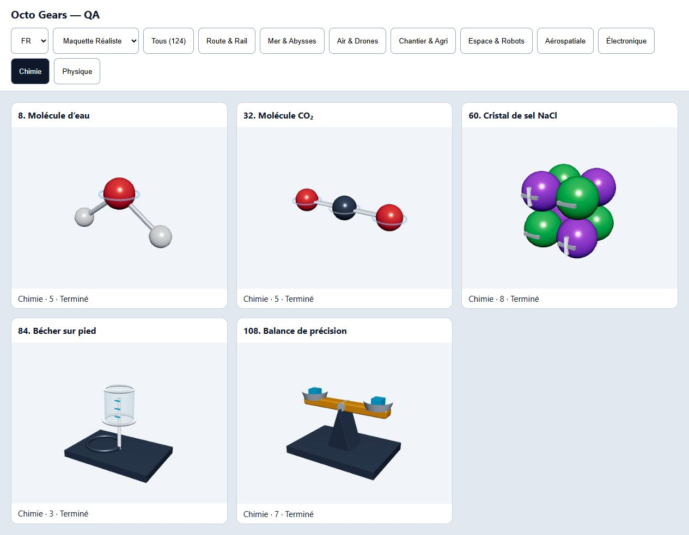
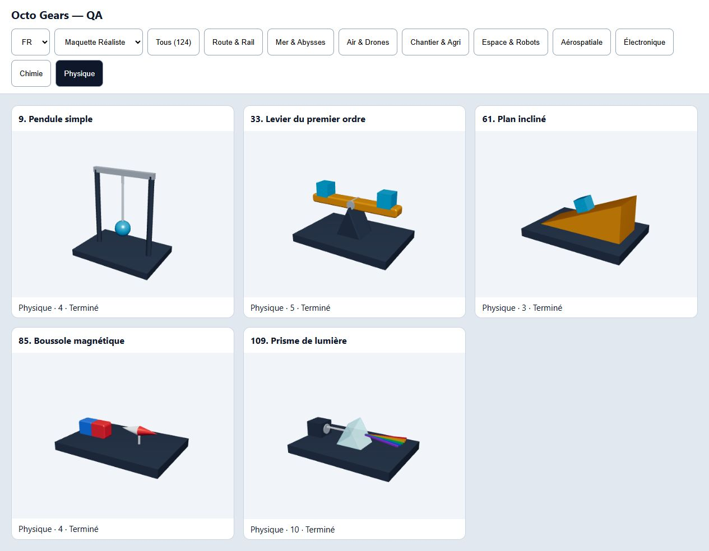
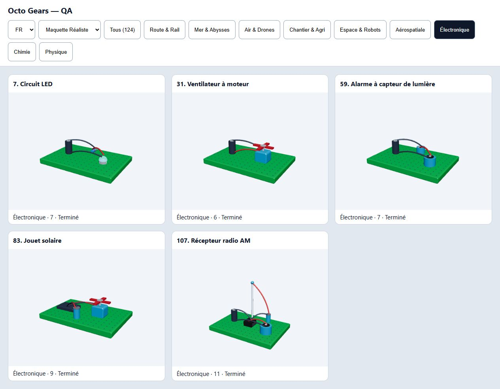
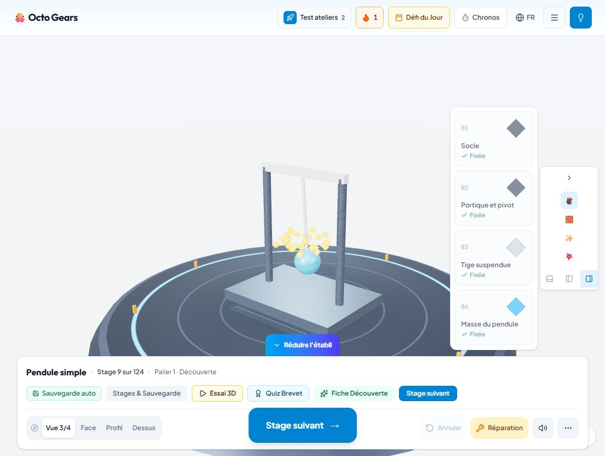

# Validation des corrections des ateliers — 5 novembre 2026

Branche : `codex/corrections-qualite-ateliers`. Suivi du [bilan initial](2026-11-05-bilan-ateliers.md).

## Corrections appliquées

- Les **15 expériences STEM** ont maintenant un inventaire dédié dans `src/data/experimentBlueprints.ts`. Les niveaux ne retirent plus les éléments indispensables à une formule ou à un appareil.
- H₂O : 1 O, 2 H, deux liaisons et angle de 104,5°. CO₂ : 1 C, 2 O, deux doubles liaisons, disposition linéaire. NaCl : fragment de réseau de 4 ions sodium et 4 ions chlorure alternés, avec signes +/− géométriques.
- Bécher gradué sur support, balance à deux plateaux avec charges égales, levier avec pivot central, rampe portant sa charge, boussole près d’un aimant horizontal et prisme avec source/rayons dédiés. Ces montages ne contiennent plus les pièces sans rapport des expériences précédentes.
- Électronique : résistance et fils pour la LED ; moteur et hélice pour le ventilateur ; capteur et buzzer pour l’alarme ; panneau et condensateur pour le jouet solaire ; antenne, module AM et écouteur pour la radio. Les fils aller/retour relient les composants ; les deux bornes de la pile sont distinctes.
- Le pendule possède un portique, un pivot, une tige et une masse réellement reliés. La tige et la masse partagent le même pivot et la même phase pendant l’oscillation ; `prefers-reduced-motion` bloque cette animation.
- La réussite utilise `isAssemblyComplete` dans **l’affichage et l’enregistrement du score**, sans allonger `App.tsx`. Elle vérifie identifiants, pièces requises, dépendances, valences exactes et boucle électrique déclarée. Une double liaison compte pour deux. Un circuit partiel n’est plus complet.
- Les **neuf catégories** utilisent un registre commun dans catalogue, records locaux, défi du jour, landing et tableau enseignant. Les compteurs utilisent le catalogue réel ; les plages de stages et de pièces sont calculées depuis les données.
- Les 15 expériences et les 5 modèles Aérospatiale disposent de métadonnées FR/EN/AR ; les 15 expériences possèdent des noms et consignes de pièces FR/EN/AR explicites. Les cartes de découverte distinguent une observation du modèle d’un record scientifique.
- Le panneau d’aperçu des pièces sort du flux : il ne décale plus les cartes au premier geste. Il est masqué pendant la sélection/pose et placé à côté du tiroir vertical avec des propriétés CSS logiques.
- Défaut supplémentaire trouvé par la régression : le style **Comics** ajoutait un contour pendant une traversée qui parcourait ensuite ce même contour, récursivement. Les meshes à contourer sont désormais collectés avant l’ajout des contours.
- Les points de la platine sont instanciés et affleurent sa surface, au lieu de former une multitude de petits poteaux. Le maximum de meshes sur les circuits de cet audit est de 24, au lieu d’un mesh par point de platine. Ce n’est pas une mesure des draw calls en production.

## Vérifications exécutées

**Contrôles finaux réussis :** `npm run lint` ; `npm test` (**432 tests, 19 fichiers**) ; `npx tsx scripts/audit-workshops.ts` (**0 erreur structurelle, 0 anomalie sémantique contrôlée**) ; `git diff --check`.

1. Tests de réussite sur les **124 modèles** ; cas négatifs sur chaque pièce manquante des 15 expériences, anciens inventaires erronés, doublons, identifiants inconnus et boucles coupées.
2. Tests indépendants des formules H₂O/CO₂ et de leurs composants, du réseau ionique, de l’identité des appareils et des traductions.
3. Test des **géométries réelles des 124 modèles dans les quatre styles** : sommets finis, boîtes non vides et libération des ressources. Les matériaux canvas sont remplacés dans ce test Node ; le rendu réel est contrôlé séparément dans le navigateur.
4. Test des sommets des cylindres moléculaires après transformation : les axes et longueurs réels suivent les liaisons H₂O/CO₂. Les extrémités des tubes des cinq circuits rejoignent leurs bornes réelles, y compris le retour au pôle inférieur de la pile. Test du pivot et de la continuité tige/masse sur un cycle complet de pendule.
5. Audit régénéré : **124 modèles, 1 064 pièces**, aucun défaut structurel. Les cinq circuits refusent un montage vide ; les cinq montages Chimie complets passent les règles adaptées à leur nature. Le script échoue désormais aussi sur les anomalies sémantiques qu’il contrôle.
6. Dans le jeu à `http://localhost:7301` : H₂O terminé avec cinq pièces, non validé à trois pièces ; prise par appui puis appui sur la silhouette, et glisser-déposer ; pendule remonté, animé, annulé puis remonté ; état complet conservé au rechargement.
7. Les neuf filtres du catalogue ont été retestés : 21/21/21/21/20/5/5/5/5 modèles, sans cartes Chimie/Physique mal étiquetées. « Tous (124) » et les titres de paliers ne contiennent plus les anciennes bornes fixes.
8. Anglais et arabe retestés sur le pendule dans le jeu ; catégorie Chimie et Physique vérifiées en arabe ; disposition RTL observée, tiroir compris. Retour au français après test.
9. Galerie de revue locale : **124 images de montages complets rendues avec les vrais matériaux dans le navigateur**, sans erreur console capturée. Les 15 expériences ont été inspectées visuellement et rendues dans les quatre styles (60 rendus). Voir `browser-style-checks.json`.

La galerie est une page de développement séparée : [ouvrir la revue locale](http://localhost:7301/qa/assembly-review.html). Elle ne modifie pas la sauvegarde du jeu, ne contourne pas ses licences et n’est pas ajoutée aux entrées du build de production. Le statut de chaque carte indique la validation d’un inventaire entièrement assemblé, pas une partie jouée par l’enfant.

### Preuves visuelles

## Limites de cette validation

- Les expériences sont des **modèles pédagogiques simplifiés**, pas des simulations électriques ou optiques. La radio ne promet plus une réception réelle et l’alarme ne promet plus un déclenchement dans l’obscurité que son circuit simplifié ne représente pas.
- Les récompenses historiques restent conservées. Les pièces obsolètes des anciennes sauvegardes sont filtrées au chargement par le mécanisme existant ; une expérience modifiée demande les nouveaux composants avant de retrouver son état complet.
- Les écarts AABB restants sont des candidats de revue, pas des défauts confirmés. Les rayons avant/après prisme sont séparés intentionnellement par le prisme ; les dépendances mécaniques n’impliquent pas toutes un contact direct.
- Aucun test physique sur tablette Android/iPad, aucune mesure FPS/mémoire GPU, aucun test vocal exhaustif ni hors-ligne PWA dans cette passe. Ne pas assimiler les rendus de galerie à 124 parcours tactiles terminés.
- Pas de déploiement. Le serveur 7301 reste disponible ; l’autre serveur 7300 a été laissé intact. Son port HMR est occupé : effectuer un rechargement manuel après modification du code.

## Note de test manuel tablette

À exécuter sur les appareils de `TABLET_TEST_PROTOCOL.md`, en priorité S1/S2/S3/S4 : ouvrir H₂O, pendule et LED ; vérifier premier appui sans décalage des cartes, pose par appui et par glissement, refus doux si dépendance absente, Annuler, reprise après rechargement, absence de pièce flottante en face/profil/dessus, puis FR/EN/AR et RTL. Refaire le pendule avec réduction des animations activée : tige et masse doivent rester statiques et connectées. Les gestes souris ci-dessus ne valident pas ces gestes au doigt.
