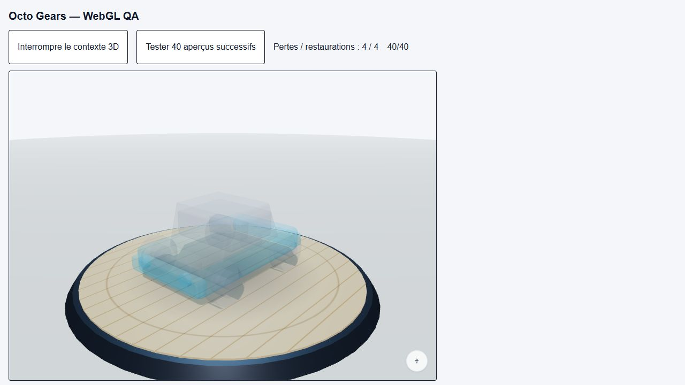
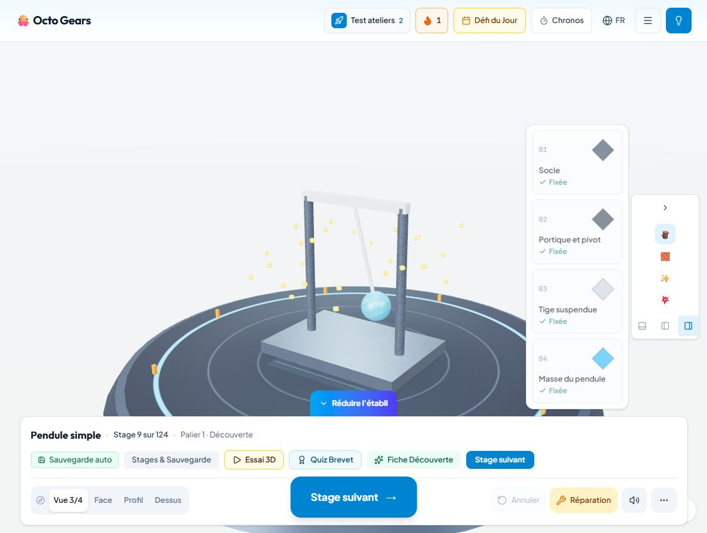

# Blocage « Réinitialisation de l’atelier 3D »

Signalement : capture Chrome du 5 novembre 2026, sur `http://localhost:7301`.

## Défauts corrigés

- Les renderers d’aperçu, de mascotte, de landing et de scène appelaient `dispose()` sans libérer explicitement leur contexte WebGL. Les montages/démontages répétés des aperçus pouvaient donc accumuler des contextes jusqu’à évincer celui de l’atelier. La destruction appelle maintenant `forceContextLoss()` après la libération des ressources. Le render target d’environnement et la scène temporaire de réflexion sont également libérés.
- Après une perte, la boucle de rendu se met en pause. L’extension `WEBGL_lose_context` est conservée **avant** la perte : sa recherche pendant une perte peut retourner `null`. Une demande de restauration est faite après 500 ms ; l’événement de restauration réveille le rendu, même si celui-ci était arrêté pour inactivité.
- Si la création du renderer échoue ou si la restauration n’aboutit pas, le panneau propose désormais **Recharger l’atelier** (FR/EN/AR, cible de 64 px). Il ne promet plus une reprise automatique certaine. La sauvegarde existante n’est pas effacée.
- Un échec de création d’un aperçu ne fait plus tomber l’atelier principal.

La cause précise de l’éviction dans l’onglet Chrome du signalement n’a pas été mesurée. Les défauts de cycle de vie et de reprise ci-dessus ont été identifiés dans le code et la récupération a été reproduite dans un navigateur local.

## Validation

Vérifications finales : `npm run lint` réussi ; `npm test` **435 tests réussis dans 20 fichiers** ; `git diff --check` réussi.

- Fixture locale utilisant le véritable `WorkshopCanvas` et les véritables `PartPreview3D` : `http://localhost:7301/qa/webgl-recovery.html`. Aucune sauvegarde de jeu n’est utilisée par cette page de test.
- Quatre pertes forcées via l’extension WebGL : **4 pertes / 4 restaurations**, retour du plateau et des silhouettes à l’écran, disparition du panneau.
- Cycle de **40 montages/démontages d’aperçus** : aucune perte supplémentaire du contexte principal.
- Atelier réel rechargé : scène et progression affichées, sans panneau de réinitialisation.
- Tests unitaires sur libération du contexte, ordre de destruction, écouteurs de perte/restauration et réveil du rendu. Les tests sur mocks sont complétés par la fixture utilisant de vrais contextes.
- Note tablette (`TABLET_TEST_PROTOCOL.md`, S1/S3/S4) : enchaîner plusieurs véhicules et prises de pièces, passer plusieurs fois par l’accueil, vérifier la reprise après interruption de l’application et le maintien de la progression au rechargement. Ce contrôle sur matériel Android/iPad reste à effectuer.

